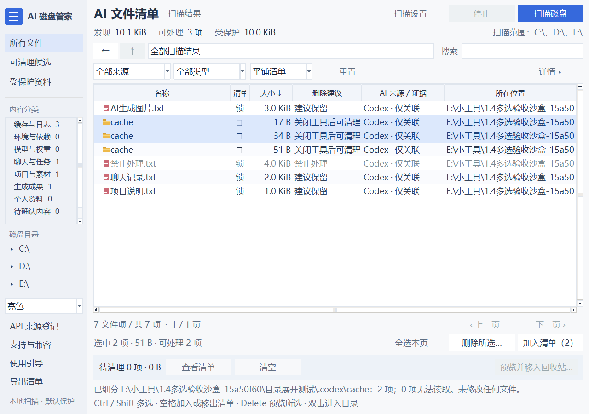
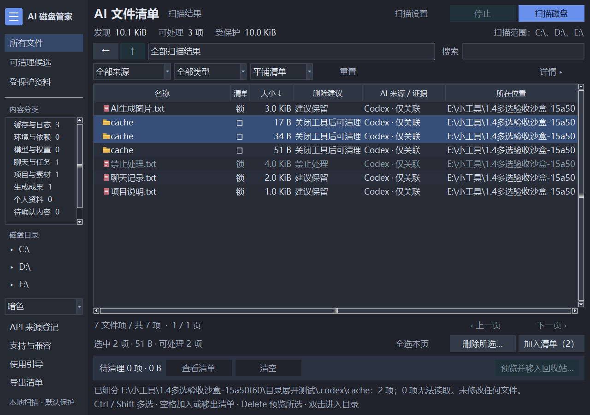
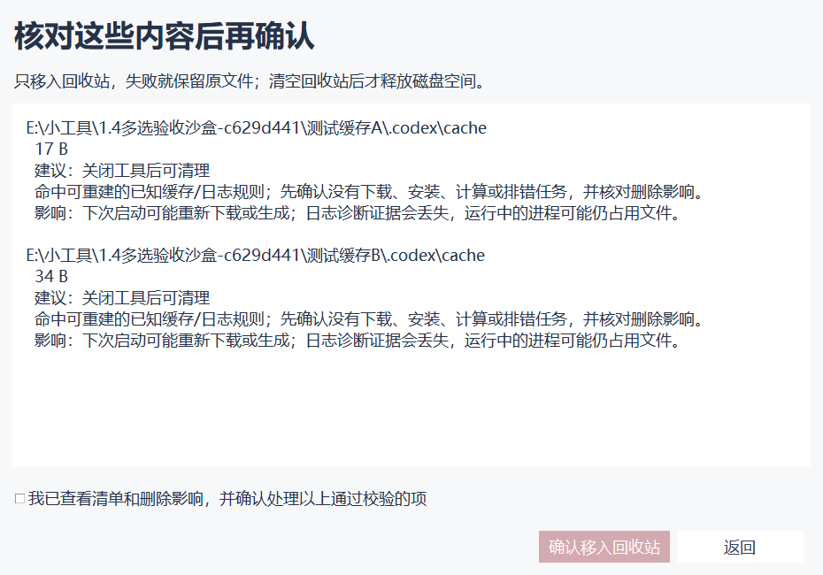

# AI 磁盘管家

**看清 AI 工具占了哪些空间，再决定清理什么。**

中文 Windows 桌面工具：按大小盘点 AI 缓存、依赖、模型、聊天、项目与生成成果，显示来源证据、处理建议及删除影响。支持目录浏览、多选和跨页清理清单，聊天记录、项目、模型与成果默认保护。

[下载 Windows 便携版](https://github.com/scarlimith/ai-disk-manager/releases/latest) · [使用说明](使用说明.txt) · [支持与边界](docs/support.md) · [验证摘要](docs/validation.md) · [反馈问题](https://github.com/scarlimith/ai-disk-manager/issues)

这是**程序发行仓库**，提供编译好的程序、说明与演示截图，**不公开应用源码**。GitHub 自动生成的 “Source code” 压缩包仅含本仓库的发行资料，不能代替程序下载。

## 下载与开始

1. 打开 [Releases](https://github.com/scarlimith/ai-disk-manager/releases/latest)，下载 `AI-Disk-Manager-1.4.0-Windows-x64.zip`。压缩包包含程序、中文说明、来源登记示例和第三方组件许可说明。
2. 解压到自己可写的文件夹，双击 `AI磁盘管家.exe`，不需要另装 Python。
3. 先查看引导。扫描默认选择有盘符的本地固定/可移动磁盘，也可以在扫描设置中指定目录。
4. 按大小、来源和内容分类查看结果，阅读建议与影响；多选后加入清理清单，核对预览后再确认移入 Windows 回收站。

也提供单独 EXE。程序会在所在目录创建 `扫描报告`，保存本地快照、主题设置、用户来源登记与清理审计；请不要放在无写权限的目录。

目标平台为 **Windows 10/11 x64**，目前仅在开发电脑实测，不能保证所有电脑或所有 AI 版本可用。发行 EXE 未数字签名，Windows 可能提示未知发布者；请核对本仓库发布地址与 `SHA256SUMS.txt`，不要为运行程序关闭防护软件。

## 能看见什么

| 查看内容 | 帮助你判断什么 |
| --- | --- |
| 九类内容、文件/目录大小、完整路径 | 空间主要被缓存、模型、依赖还是项目占用 |
| AI 来源与证据等级 | 哪些是写入记录确认，哪些只是目录关联或人工登记 |
| 删除建议、影响和保护原因 | 清理后是否需要重下载、重建环境，是否涉及成果或聊天 |
| 目录浏览、类型树、磁盘目录树、文本/图片预览 | 核对实际文件，再做选择 |
| Ctrl/Shift 多选、跨页清理清单 | 集中检查多项内容并批量处理 |
| 亮色、暗色、跟随系统、使用引导 | 按自己的习惯浏览和操作 |



*截图使用自行创建的测试文件，路径属于测试沙盒；10.1 KiB 是演示数据，不是用户磁盘扫描结果或实际释放容量。*



## 来源判断保持证据边界

- **确认新增**：有成功写入证据，才标明生成者。
- **确认修改**：显示修改者，不将用户原有文件当作 AI 创建。
- **仅关联 / 目录线索**：说明关联，不证明逐文件作者。
- **人工登记**：适合 API、自写脚本、自定义输出目录，声明默认保护，不视为独立验证。
- **未知**：证据不足就保留未知，不靠文件名、体积或扩展名猜作者。

写入溯源目前仅部分支持 Codex / Claude Code 本地 JSONL。没有留存来源记录的任意 API 输出，不能全部自动认出；可以使用程序中的 “API 来源登记”，或导入 [来源登记示例](API来源登记示例.json)。不要在登记中填写密钥或请求/响应正文。

## 删除前有明确边界

聊天、项目、模型、生成或修改成果、未知来源默认保护；建议不会自动勾选任何文件。需要处理时，先逐项审核保护，再查看清单和影响，最后主动确认。

系统、凭据、数据库、应用状态、链接、扫描不完整项和本工具资产禁止处理。删除前会检查路径、内容快照、保护规则和回收站容量；校验失败则停止，没有永久删除兜底。内容移入系统回收站后可由 Windows 恢复，**清空回收站后才实际释放空间**。



不按体积把模型、项目和生成成果称为垃圾。目录统计是已发现内容的小计；逻辑大小也不等于一定可释放的空间。

## 支持范围与隐私

当前实现 17 类目录/结构规则生态，包括 Codex、Claude、Claude Code、Cursor、Windsurf/Codeium、GitHub Copilot、Continue、Aider、ChatGPT、Ollama、LM Studio、Hugging Face、ModelScope、ComfyUI、Stable Diffusion WebUI、Fooocus、共享依赖。**规则支持不等于所有版本、安装渠道和文件作者都已验证。**完整边界见 [支持说明](docs/support.md)。

正常使用在本地运行，不上传扫描结果、聊天、文件正文或 API 密钥，不需要 AI API 调用。[隐私说明](PRIVACY.md) 解释本地保存的内容。反馈问题时请隐藏用户名、个人路径和项目名称，避免直接上传扫描报告。

## 版本与反馈

当前版本：**1.4.0**。EXE：16,899,706 字节（约 16.12 MiB）。SHA-256：

```text
A06692CDB24E8A780421C85D2568B18C3C04DC1F47FED50C151A647B1257663B
```

验证覆盖多选、保护审核、跨页清单、原生回收站批量处理及独立 EXE 启动。128 项回归检查中 127 通过、1 因符号链接创建权限跳过，无失败；测试只处理自行创建的微小沙盒内容。[查看具体范围与限制](docs/validation.md)。

欢迎在 [Issues](https://github.com/scarlimith/ai-disk-manager/issues) 描述系统版本、程序版本、复现步骤与已隐藏私人信息的截图。此工具为独立项目，与所列 AI 产品没有官方关联或背书。

本发行仓库不采用 MIT 或其他开源许可证；组件原许可见 [第三方说明](THIRD_PARTY_NOTICES.md)。

---

AI Disk Manager is a Chinese-language, portable Windows x64 utility for reviewing AI-related storage, provenance evidence and deletion impact. This repository distributes binaries and documentation only; application source is not published. Review before cleanup; protected data is not automatically selected, and accepted deletions go to the Windows Recycle Bin.

